# Fin-ally Supported

## Shark-fin supports for long, flat, tilted overhangs: a hobbyist's field guide and a defensive publication

**Matthew Armstrong** ([@The-Dorkknight](https://github.com/The-Dorkknight))\
Version 1.0 · First published 19 October 2026 · Text and figures: CC BY-SA 4.0 · Code: PolyForm Noncommercial 1.0.0\
Repository: <https://github.com/The-Dorkknight/fin-ally-supported> · Software: <https://github.com/The-Dorkknight/cura-shark-support>

> **Read this first.** Every number in this paper comes from geometry code, slicer estimates or G-code. **Nothing
> has been printed and broken yet.** Where a result is a slicer estimate or a simulation it says so. Section 8 is a
> test plan for anyone with a printer and a free evening.

---

### Abstract

Printing a long box tilted onto one of its long edges makes its walls strong along their length, but turns its base
into a long, flat overhang at 30–55°. That is near, or just past, the angle where slicers start adding support, and over 150 mm it tends to sag and
curl.
Normal slicer supports fix it by filling the space under the whole face with a forest that welds itself to the
part. This paper describes **shark-fin supports**: a row of thin vertical plates that run *downhill* under the face,
follow its slope, touch it only at small teeth, stop short of the top with a blunt flat tip, and stand on a crossbar
foot and a one-layer brim pad. They are cheap (on the test box, 1.68 m of filament and about 40 minutes for five
fins, slicer estimate) and should come off in one piece each. The method is implemented as an open Cura plugin with a
toolbar button that lets you click the face you want supported. Section 7 is a **defensive disclosure**: the method
and a long list of variations are published as prior art, to make it much harder for anyone to patent them and
charge hobbyists for them. They are dedicated to the public.

---

## 0. Why this paper exists

1. **To keep it free.** A published method is prior art, which makes it much harder for anyone to get a valid
   patent on it later. This paper puts the shark fin, its teeth, its blunt top, its feet and its many cousins on the
   public record with a date, so that a company filing on them later has this to get past first.
2. **To write down the dead ends.** Every version so far had a mistake in it that looked like a good idea at the
   time. Section 5 lists them, so nobody has to make them twice.
3. **To bring makers together.** A plugin is a tool; a paper is an invitation. Print the test plan, post the
   results, fork the code, prove me wrong. Everyone who contributes gets credit in the next version.
4. **Selfish reasons.** Publishing things like this tends to bring more interesting 3D printing tools and tricks
   back to me. It also makes me roughly 0.3 % more employable per paper, which, compounded over a few more
   papers, is a very efficient use of an evening.

## 1. The problem

### 1.1 Tilting for strength

FDM parts are weakest between layers. A long box printed flat is strong along its length only in the layers
themselves; printed on its end it is strong in the wrong direction and wobbly. A common compromise is to **stand
the box on one long edge and tilt it**, so the long walls run along the layers and the base and one side become
sloping faces (Figure 1).

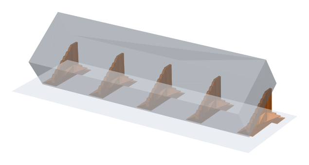

*Figure 1. The 35° test box (grey, see-through) and its fins (orange).*

The test part used throughout is a 150 × 40 × 25 mm box rotated 35° about one long bottom edge, so its base
becomes a **55° overhang** (in Cura's convention: 0° is a vertical wall, 90° a flat ceiling). It is deliberately
boring. Boring parts make honest tests.

### 1.2 Why "it's under the angle" is not enough

Slicers and rules of thumb treat overhangs up to about 45–55° as printable without support. That is true for a short
ledge. Over a long face several things add up:

- each layer's edge sticks out a little further than the one below, and a long free edge cools unevenly and curls
  upwards, which the nozzle then hits;
- the lowest part of the face is printed first and has nothing above it to hold it flat;
- a long, thin, freshly printed edge sags under its own weight and the drag of the nozzle.

The usual result is a wavy, curled base, or a print knocked loose halfway through.

### 1.3 What slicers offer

Turning on normal supports fills the space under the whole base with support. It works, but it uses a lot of
plastic and time, it bonds along every layer of the face, and on a tilted part it leaves a large scarred surface.
Tree supports use less material but branch to many contact points and can be awkward to remove from a long flat
face. Neither knows that this particular overhang only needs **a few stiff ribs** to stop it curling.

## 2. What already exists

This section is an informal prior-art search, not a professional one. It is here to give credit and to be clear
about what is new.

- **Slicer supports.** Cura, PrusaSlicer and OrcaSlicer offer grid/line supports, tree or "organic" supports, support
  blockers and enforcers, painted supports, and "support meshes": any shape the user loads can be marked to print as
  support ([Prusa Knowledge Base][prusa-support]; [Printago guide][printago]).
- **Hand-drawn sacrificial ribs.** Designers have long added thin ribs to a model in CAD to hold up an overhang and
  snapped them off afterwards ([Hubs overview of supports][hubs]). That is the same idea as a fin, made by hand,
  usually as a plain plate that bonds along its full edge.
- **Ribbed support vaults** (Tricard, Claux and Lefebvre, *Computer Graphics Forum*, 2019) grow rib-like internal
  walls inside hollowed FFF prints to hold up internal overhangs ([project page][vaults]). They are walls that
  support from below, but inside the object and merging into it.
- **Teeth on metal supports.** In metal powder-bed printing, block supports often meet the part through small
  teeth, whose size, shape and penetration affect the strength of the support ([Materialise][materialise]). The fins'
  teeth borrow from that habit.
- **US 9,469,057 (3D Systems, priority 2012).** Claims a method of printing an FFF support whose upper portion
  contacts the part at discrete "fine points", with a retract, lift, move, lower sequence between them
  ([Justia][us9469057]; [Google Patents][us9469057g], which lists it as active until about 2034). Worth knowing:
  in the top layers of a fin, each tooth tip is a small separate island in the slice, and slicers usually retract
  and travel (and may lift) between islands. **How this patent relates to Shark Support has not been assessed.**
  If it matters to you, ask a patent professional; nothing here is legal advice.

As far as this search found, nobody describes **downhill fins generated automatically under a flat tilted face,
contacting through teeth, cut short with a blunt top, braced by a crossbar foot and brim pad, with a click-to-pick
face selection**. If you know of earlier work, please open an issue: the next version will credit it.

## 3. Shark fins in one page

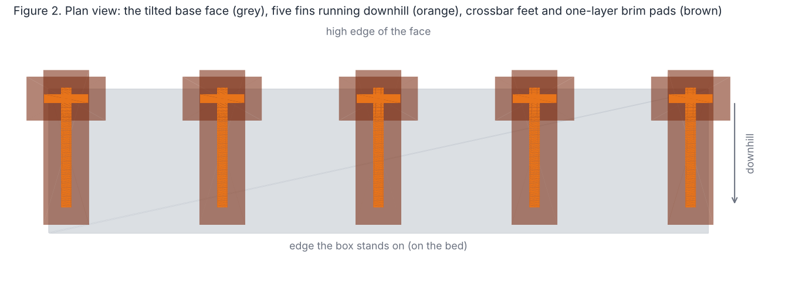

For each flat face that faces downwards:

1. **Downhill.** Work out the direction a ball would roll down the face, flattened onto the bed. Fins run that way,
   spaced evenly across the face (30 mm by default, 4 mm in from the sides). Figure 2.
2. **Measure.** Along each fin line, cast vertical rays up from the bed every 0.5 mm to find the part's underside.
3. **Shape** each fin as a thin vertical plate (2.4 mm thick at the bed, 1.2 mm at the top) whose top edge sits 1 mm
   under the part, with **teeth every 3 mm** that reach up to 0.15 mm short of it. The **first two teeth** from the
   low end reach 0.1 mm *into* the part, so the start of the overhang, where curling begins, is anchored.
4. **Stop early.** The fin follows the part only to **85 %** of its height; the part bridges the rest. The fin ends
   in a **5 mm flat top**, then goes **straight down**.
5. **Stand it up** with a 4 mm high crossbar foot under the tip and a 4 mm wide, one-layer brim pad.
6. **Print it as a solid little part** next to the model, not as Cura "support".

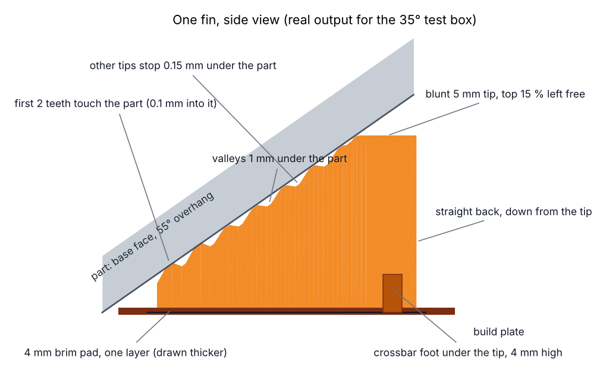

*Figure 10. One fin of the test box, side view, drawn from the code's output and labelled.*

## 4. The method in detail

This section is written so that someone could rebuild the method from it.

### 4.1 Finding the face

**Automatic mode.** Triangles of the model that face downwards are grouped into flat faces: two triangles join when
they share an edge and their normals differ by less than 3°. A face qualifies when its overhang angle α (the angle
between its outward normal and the horizontal, so 0° is a wall and 90° a ceiling) lies between 20° and 70°, its area
is at least 300 mm², and it spans at least 15 mm downhill, measured in plan.

**Picked mode.** The user clicks the face. The slicer reports the 3D point under the mouse (in Cura, its picking
render pass). The plugin finds the triangle that contains the point (the projection of the point lies inside the
triangle within a small tolerance, and the point is within 1 mm, or 1 % of the model size, of its plane), checks
that it faces downwards and is not a flat ceiling, and uses the flat face that triangle belongs to. A picked face
ignores the automatic angle and size limits: the user has said it needs help.

### 4.2 Direction and layout

For a face with unit normal **n**, gravity **g** = (0, 0, −1) projected into the face's plane is
**d** = **g** − (**g**·**n**)**n**, the steepest descent. Its horizontal part, normalised, is the *downhill* direction
**h**; **c** = **ẑ** × **h** is *across*. Projecting the face's corners onto **c** gives its width; fins sit at
evenly spaced positions across it, a side margin from each edge, at most a set spacing apart (one fin in the middle
if the face is narrow). A flat ceiling has no downhill and is skipped.

### 4.3 Measuring the underside

Along each fin line, at steps of 0.5 mm in **h**, a vertical ray goes up from the bed. For a closed mesh the first
surface a ray meets from below always faces downwards, so only downward triangles are indexed, in a uniform grid in
plan. Each hit gives the height of the part above the bed and which triangle was hit. The fin keeps the **longest
continuous run** of samples that hit its own face and are at least the *start height* (4 mm) above the bed, so it
never climbs onto a neighbouring face or across a gap. Below the start height the face is short enough to print on
its own.

### 4.4 The top edge: relief, teeth and anchors

Let s run along the fin from its low end s₀, and z(s) be the underside height. The fin's top edge is
z(s) − *relief* (1 mm). Teeth are placed from the low end: the first tooth's ramp starts at s₀, then one every
*pitch* (3 mm), and a last one near the end. Each tooth ramps up over 1 mm, stays flat for 0.6 mm, and ramps down.
At its flat top it reaches z(s) − *gap* (0.15 mm) or, for the first *N* anchor teeth (2), z(s) + *overlap*
(0.1 mm, half of a 0.2 mm layer). The anchors therefore print touching the part's outer wall in the same layers
(Figure 6); the other tips stop just short.

Why teeth and not a plain edge: a plain edge 0.15 mm under a sloping face touches it along every layer. Teeth turn
that into a dotted line, so the fin snaps off with a short pull and leaves small, evenly spaced marks.

### 4.5 Stopping short, with a blunt top

The fin follows the part only up to a height z_cut = (1 − *top cut*) × the highest edge height it would otherwise
reach (top cut 15 %, so 85 %). Teeth near the cut are flattened to z_cut so nothing pokes above it. From there the
fin runs **flat for 5 mm** (*tip length*), then ends.

Why: a sharp tip means the last layers of the fin are a few millimetres long or less. The printer brakes and
accelerates for each tiny move, which is slow and prints badly. With a 5 mm flat top, no layer of the fin is shorter
than 5 mm. And the top 15 % of a long tilted face is the part closest to its own upper edge, which is already held
by the rest of the box.

### 4.6 The back edge

By default the fin goes **straight down** from the end of the flat top. Variants (Figure 9) lean the back out at a
set angle (20° from vertical) for a wider base, or make it round (a quarter ellipse) or concave. Each point of the
back is checked against the part above it and lowered if needed, and the back never goes below a 0.6 mm stub.

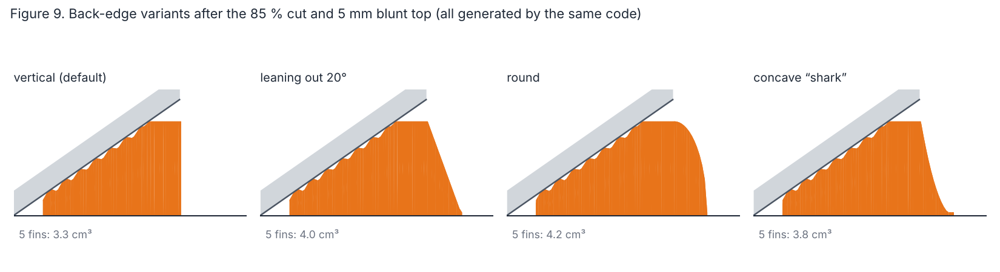

### 4.7 Thickness

The fin is a "ribbon" of columns along s. Each column has a bottom width (2.4 mm), a top width that tapers linearly
with height from 2.4 to 1.2 mm, and a top height. Neighbouring columns are joined into a closed, outward-facing
mesh. Thicker at the bed, where bending is worst; thin at the top, where the teeth are.

### 4.8 Crossbar foot

A bar across the fin, 2 mm thick and 4 mm high, its length ¼ of the fin's footprint (at least 10 mm), under the
middle of the flat top, where the fin is tallest. Fins with a footprint over 100 mm get a second bar halfway
between the low end and the 85 % cut.
A bar is lowered if the part comes within the relief above it, and skipped if that leaves less than 1.5 mm.

### 4.9 Brim pad

A rectangle one first layer thick, 4 mm wider than the fin on every side, plus one around each crossbar. Where the
part itself comes close to the bed at the low end, the pad is trimmed until the part is at least 1 mm above it, so
it never welds to the part's own edge.

### 4.10 Solid part, not "support"

Cura can print any mesh as support, but its support settings are global: density, walls and pattern cannot be set
per object, so a 1.2 mm fin printed as support would come out as a few sparse lines. And in the Cura releases
checked, the setting called "support brim" prints a brim *inside* support areas, not around them. So by default the
fins are a **separate ordinary object** with three per-object settings: infill 100 %, support off, and "union
overlapping volumes" on, so a fin, its crossbar and its pad print as one piece. The gaps between fin and part are
in the geometry itself. A "print as support mesh" switch is kept for comparison.

### 4.11 In the slicer

In Cura the method is a **toolbar button** under move, scale and rotate (Figure 7). Its panel has *Pick face*,
*Auto*, *Remove all* and *Settings*. Picking a face that already has fins replaces them; *Auto* replaces a model's
earlier fins. All of it is undoable. For other slicers a command line tool writes the fins as an STL to load next to
the part.

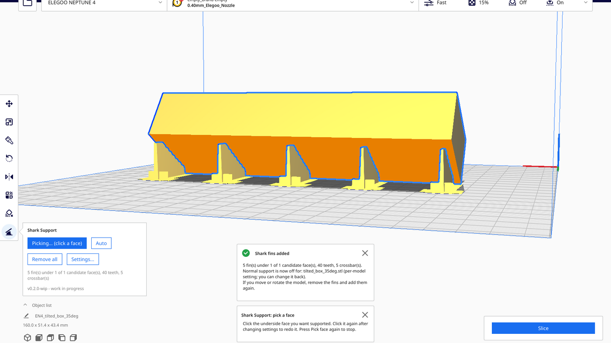

*Figure 7. Cura (from source) with the Shark Support panel open: a mouse click on the underside, sent by the test
driver (xdotool, virtual display), made these fins.*

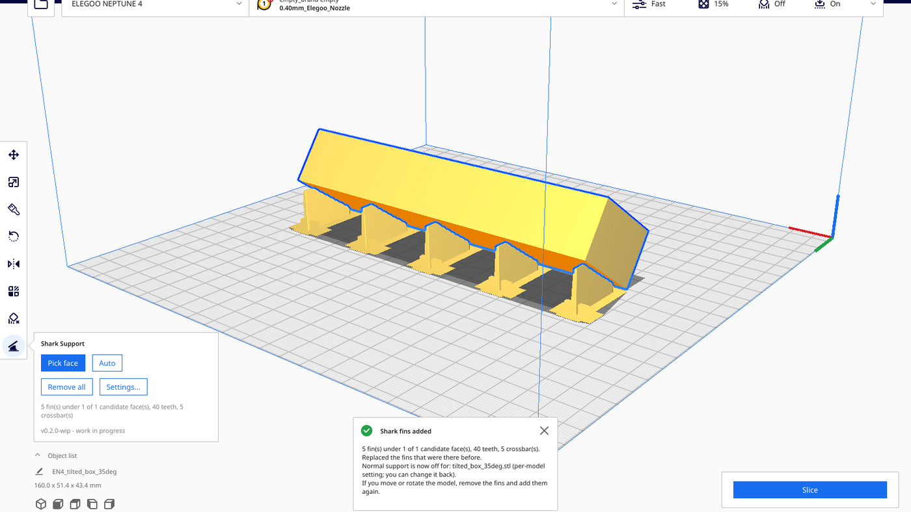

*Figure 8. The same box after Auto, from behind: five fins with their feet and pads.*

### 4.12 All the numbers

| Parameter | Default | Meaning |
|---|---|---|
| Overhang angle range (auto) | 20–70° | Which faces *Auto* supports |
| Smallest face, shortest slope (auto) | 300 mm², 15 mm | Faces smaller than this are left alone |
| Fin spacing, side margin | 30 mm, 4 mm | Across the face |
| Start height | 4 mm | Fins start where the face is this high |
| Thickness at bed / top | 2.4 / 1.2 mm | Linear taper with height |
| Relief | 1 mm | Gap under the part between teeth |
| Tooth pitch, tip, ramp | 3, 0.6, 1 mm | Tooth shape |
| Tip gap | 0.15 mm | Ordinary teeth stop this far under the part |
| Anchor teeth, overlap | 2, 0.1 mm | First teeth from the low end reach into the part |
| Top cut | 15 % | Fin stops at 85 % of its height |
| Tip length | 5 mm | Flat blunt top |
| Back | vertical | Or leaning (20°), round, concave |
| Crossbar | ¼ of footprint × 4 mm high × 2 mm | Under the tip; second one over 100 mm |
| Brim pad | 4 mm wide, one first layer | Around fin and crossbar |
| Ray step | 0.5 mm | Profile resolution |

## 5. How it got here: the mistakes, in order

Most of the versions below were built, tested in code and looked at; two were design dead ends caught before the
first release. Each taught something.

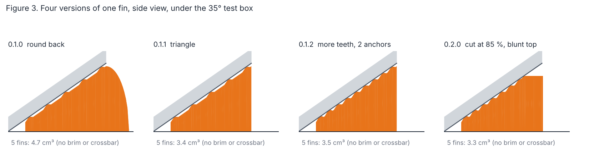

*Figure 3 is drawn with today's code and each version's settings, so tooth positions follow today's rule.*

1. **0.1.0: the actual shark.** A round back edge, because it looked like a fin and seemed sturdier. It was
   neither: the crossbar already stops the fin tipping over, and the round back was a strip of plastic sticking out
   past the part. Measured later: 2.27 m of filament against 1.74 m without it (Figure 4).
2. **0.1.0: teeth centred along the fin.** The row of teeth was centred, so the first contact could sit up to 15 %
   of the way in, leaving the start of the overhang, where curling begins, unheld. Fixed in 0.1.1 by starting at the
   low end.
3. **Before 0.1.0 (design): "support brim" is not a brim.** The plan was to use Cura's support brim for the 4 mm pad. Reading Cura's
   settings showed it prints inside support, not around it. The pad became geometry.
4. **Before 0.1.0 (design): fins as Cura support.** Printed at the global support density, a fin is a few lines. Fins became solid
   objects (section 4.10).
5. **0.1.1: the triangle.** Straight back: 23 % less filament (27 % less fin volume). Still a sharp tip.
6. **0.1.2: more teeth, two anchors.** Pitch halved from 6 to 3 mm. The first two teeth reach 0.1 mm into the part;
   the rest stop 0.15 mm short (was 0.2). Almost free: 1.76 m instead of 1.74 m. With 3 mm pitch the valleys
   between teeth are only 0.4 mm long, so the top edge is effectively a saw blade. If it grips too hard, 4 mm pitch
   opens the valleys again.
7. **0.2.0: the blunt top.** Looking at a Cura preview made the problem obvious: the tip of a triangle is a column
   of tiny, slow layers. Cutting at 85 % with a 5 mm flat top fixed it and saved time: 1.68 m, about 40 minutes.
8. **0.2.0: the leaning back, measured and demoted.** The first sketch of the new shape had the back leaning out to
   the bed. Measured, it cost more than going straight down (1.97 m, about 42 minutes). It is now an option for when
   a wider base matters more than plastic.
9. **Plugin plumbing, for other plugin authors:**
   - Uranium's signals hold *weak* references, so connecting a lambda silently does nothing. Connect a method.
   - Cura caches "is this a support mesh" per object and only refreshes it when a setting change is announced;
     setting it directly leaves the cache stale.
   - A plugin's first log lines can appear before Cura's log file is open; log again once the app has started.
   - `UM.Dialog` takes only visual items as children: a `Connections` object in the wrong place makes the whole
     dialog fail to load.
   - Toolbar icons are SVGs that Cura recolours by inserting a `fill` attribute into the `<svg>` tag. An icon that
     already has one there becomes invalid.

## 6. Numbers

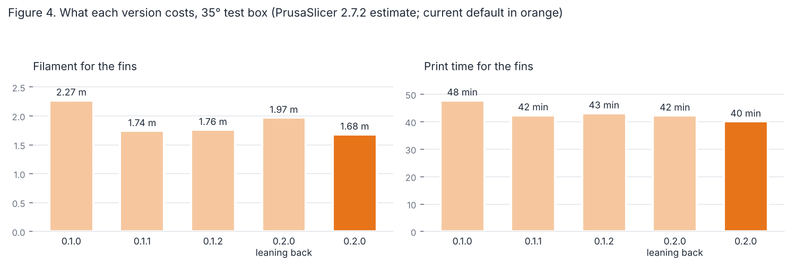

All from PrusaSlicer 2.7.2's command line on the fins alone: 0.2 mm layers, 0.4 mm nozzle, two perimeters,
PrusaSlicer's default speeds. These are **slicer estimates**, not stopwatch times.

| Version | Fins (5) | Filament | Time (estimate) | Volume (code) |
|---|---|---|---|---|
| 0.1.0 round back | sharp, to the top | 2.27 m | 48 min | 4.7 cm³ |
| 0.1.1 triangle | sharp, to the top | 1.74 m | 42 min | 3.4 cm³ |
| 0.1.2 more teeth | sharp, to the top | 1.76 m | 43 min | 3.5 cm³ |
| 0.2.0, leaning back | blunt, 85 % | 1.97 m | 42 min | 4.0 cm³ |
| **0.2.0 default** | **blunt, 85 %** | **1.68 m** | **40 min** | **3.3 cm³** |

*Volumes are without brim pads and crossbars; filament and time include them. The 0.1.0 and 0.1.1 volumes are
redrawn with today's code, so their tooth positions follow today's rule.*

**Does the slicer print what the code drew?** Figure 5 plots every extrusion in the real G-code within 0.5 mm of the
middle fin. The fin is solid, follows the part with a stepped gap, stops below the top of the face with a flat top,
and goes straight down at the back. Figure 6 zooms in on the low end: the anchor teeth's lines run into the part's
outer wall, while further up there is a clear gap at every tooth.

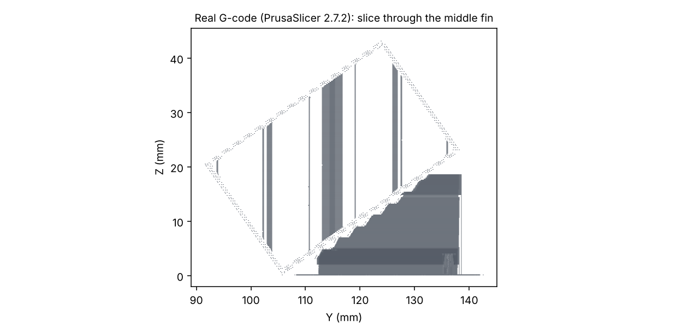

*Figure 5. Every extrusion in the PrusaSlicer 2.7.2 G-code within 0.5 mm of the middle fin, seen from the side.*

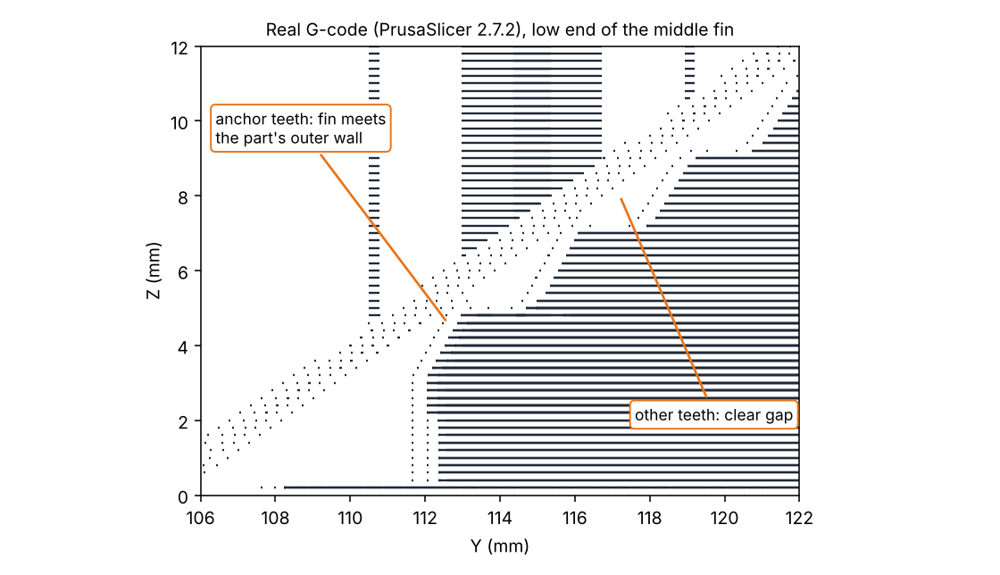

*Figure 6. The low end of the same fin, zoomed in.*

**Speed of the code.** A 196,608-triangle version of the test box took about 2 s to process (1.6–2.3 s across
runs) on the development machine; the 12-triangle box takes 0.02 s. Not yet timed on a 7th-generation Core i3, which is the target for
everything in this project.

**A box on its corner.** Rolled a further 12° onto a corner, both faces next to the standing edge qualify, and the
same code makes ten fins; with the anchors switched off, the closest tooth is exactly 0.15 mm under the part
(Figure 11).

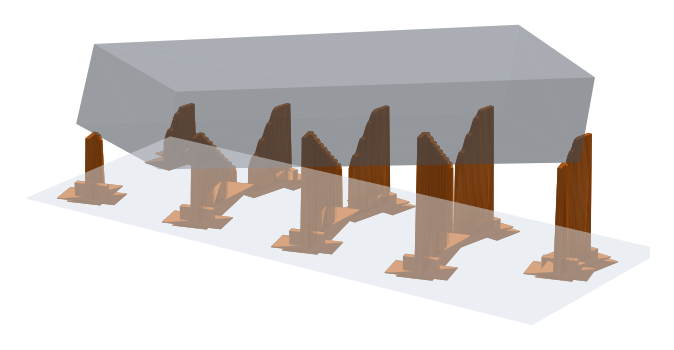

*Figure 11. The box rolled 12° onto a corner: two faces, ten fins.*

## 7. Defensive disclosure: the method and its variations

The following are disclosed as part of this publication, alone and in any combination, for FDM/FFF and for any
other layer-wise process where they make sense. They are dedicated to the public.

**7.1 The core.** A support structure for a downward-facing surface of an object being built layer by layer,
comprising one or more upright plates ("fins") generated from the object's geometry, each running substantially
along the downhill direction of the surface in plan, whose upper edge follows the surface at a clearance, with
contact features ("teeth") that approach or meet the surface at intervals, the plates standing on the build
surface, optionally braced by a foot and widened at the base by a pad.

**7.2 Finding where fins go.** Automatic detection of flat or near-flat downward faces by angle band, area and
reach; grouping by normal tolerance; user selection by clicking a point on the surface, by painting, by drawing a
line or region, or by selecting a face in CAD; selection of faces by curl risk (length of free edge, cooling time,
distance from the bed, material); faces of any size, including faces normally considered printable; curved or
faceted surfaces approximated piecewise; surfaces of multiple objects at once.

**7.3 Layout.** Fins along the downhill direction; at an angle to it; fanned from a point; in a grid or herringbone;
crossing pairs (X); spacing fixed, scaled with overhang length, with angle, with face width, with material, or set
so that the unsupported span between fins stays below a limit; denser near the low edge where curling starts;
offset between neighbouring faces; joined across faces into one structure.

**7.4 Contact.** Teeth of any profile (trapezoid, triangle, rounded, stepped); points, ridges, pins, cones, fingers;
teeth whose pitch varies along the fin (denser at the low end); anchor teeth that touch or overlap the part,
anywhere along the fin and in any number, with any overlap; teeth that stop short at a gap of any size, fixed or
proportional to the layer height; teeth printed with a different material, extruder, temperature, speed, flow or
cooling; teeth with a breakaway neck or perforation; teeth that touch only in alternate layers; an interface layer,
dissolvable or not, between teeth and part; contact made from the side rather than from below.

**7.5 Profile.** A top edge that follows the surface at a relief; fins that stop at any fraction of the surface's
height (the part bridging the rest), measured by height, by length along the slope or by the angle of the
remaining span; a blunt top of any length or a minimum layer length, so that no layer of the support is shorter
than a set length; a flat, rounded or stepped top; backs that are vertical, leaning at any angle, round, concave,
stepped, or shaped to the minimum stable footprint; fins that start at a set height or reach down to the bed edge.

**7.6 Section and structure.** Thickness constant, tapered, stepped or thickened at the base; solid, hollow,
double-walled, corrugated, perforated, lattice-filled or sparse-infilled fins; fins with stiffening ribs or a
flange along the top; fins printed as part of the model, as a separate object, as a slicer "support mesh", or
directly as toolpaths at G-code level.

**7.7 Feet and pads.** A crossbar of any length, height and position (under the tip, at the middle, at the low end,
several); T, X, H or gusset-shaped feet; triangular gussets between fin and bed; a pad of any width and thickness,
one or more layers, trimmed clear of the part, shared between neighbouring fins, or replaced by a raft or by mouse
ears; tie bars linking fins to each other above the bed.

**7.8 Workflow.** Generating fins in a slicer, a CAD program, a mesh editor, a plugin, a command line tool or a
web service; replacing earlier fins when the same face is picked again; regenerating fins when the object is moved;
removing all fins at once; previewing before adding; combining fins with tree or normal supports elsewhere on the
same part; automatically turning off the slicer's own supports under the faces that have fins.

## 8. Test plan (please print this)

Print the 35° test box (`data/tilted_box_35deg.stl`, 150 × 40 × 25 mm) four ways, same filament, same settings:

1. **No support.** Photograph the base, measure curl at the low edge and mid-face with a feeler gauge or a ruler on
   a flat surface.
2. **Slicer supports** (normal, then tree), touching build plate only.
3. **Shark fins, defaults.**
4. **Shark fins, anchors off** (`Anchor teeth` 0).

For each, record: filament and time (slicer estimate and real), whether it finished, curl or sag of the base,
time to remove the supports by hand, and the state of the base afterwards (photo). Then, if you are keen: tooth pitch
3 vs 4 vs 6 mm; top cut 0, 15 and 25 %; a 45° box. Post your results as a GitHub issue or discussion with photos.
Everyone who does gets credited in version 1.1.

## 9. Limitations and open questions

- **Nothing has been printed yet.** Whether 2 anchor teeth hold, whether 0.15 mm ordinary tips stay free, and
  whether a 1.2 mm fin top is stiff enough on a tall part are all open.
- Flat faces only. Curved undersides are ignored.
- The fins are a separate object: move the model and the fins stay behind.
- Near the top of each fin the tooth tips are separate islands in the slice, so the slicer travels between them;
  how much that costs in time has not been measured.
- At a 55° overhang an ordinary tooth tip 0.15 mm under the part is only about 0.2 mm from it sideways in the same
  layer, less than a line width, so even ordinary teeth may bond lightly.
- In Cura the plugin was run from Cura's own source (5.15 development branch) with stand-ins for its C++ parts; the
  face was picked with a mouse click sent by a test driver. Slicing in Cura, Cura 5.0–5.10, and Windows and Mac were not tried.

## 10. Fin-ally, a social species

Infant sharks do, do, do support prints well.

(With apologies to a certain children's song, which is now going to be in your head until at least Thursday.)

The serious point behind the joke: this method grew one review at a time. A fin that looked right in a diagram
looked wrong in a slicer preview; a "more efficient" back edge turned out to cost more when measured. Each change
came from someone looking at the output and saying "that bit's daft". The fastest way to find the next daft bit is
more people looking. Print it, break it, measure it, and tell the rest of us. Makers, like fins, are stronger when
they are spaced sensibly and braced against each other.

## 11. Code, data and how to reproduce

- **The plugin** (Cura toolbar tool, menu, installer, command line tool, 22 geometry tests):
  <https://github.com/The-Dorkknight/cura-shark-support>, version 0.2.1-wip (fin shapes as in 0.2.0).
- **In this repository:** `code/shark_core.py` (the geometry, numpy only), `data/` (the test boxes and their fins as
  STL), `tools/make_figures.py` (redraws Figures 1–4 and 9–11 from the code), `tools/gcode_side_view.py` (draws
  Figures 5–6 from any G-code), `tools/build_paper.py` (builds the web page and PDF).
- Figures 5 and 6: PrusaSlicer 2.7.2, `--layer-height 0.2 --first-layer-height 0.2 --nozzle-diameter 0.4
  --perimeters 2 --fill-density 15%`, the box and its fins merged. Figures 7 and 8: Cura from source, run by the
  plugin's own test driver under a virtual display.

## 12. How this was made

The geometry code, plugin, tests, measurements and literature search were done with an AI assistant (Claude,
by Anthropic) working to my design intent, reviewed and steered by me at each step: the shark fin, the point
contacts, the 4 mm brim, the crossbar, the triangle, the anchors, the blunt top and the toolbar button were all my
calls; the assistant did the typing, the maths and the measuring, and owned up to its own mistakes listed in
section 5. I think saying so plainly makes the work more trustworthy, not less.

## 13. Licence, and keeping it free

- **Text and figures:** [CC BY-SA 4.0](LICENSE.md). Share and adapt, credit me, keep it under the same licence.
- **Code:** PolyForm Noncommercial 1.0.0 ([LICENSE-CODE.md](../LICENSE-CODE.md)). Free for hobbyists; commercial use
  needs permission.
- **The methods** in sections 3, 4 and 7 are dedicated to the public. This paper is a defensive publication: its
  purpose is to be prior art, to make it much harder for anyone to patent these methods and restrict their use.

## 14. Disclaimers

Not legal advice: what counts as prior art, and whether something infringes a patent, is decided by patent offices
and courts. Not engineering certification: printed supports can fail, and parts can detach from the bed. Use at
your own risk. Not affiliated with UltiMaker, Prusa Research, 3D Systems, Materialise or anyone else named here.

## 15. How to cite

Armstrong, M. (2026). *Fin-ally Supported: Shark-fin supports for long, flat, tilted overhangs. A hobbyist's field
guide and a defensive publication.* Version 1.0, first published 19 October 2026.
<https://github.com/The-Dorkknight/fin-ally-supported>

## References

- Prusa Research, "Support material", Prusa Knowledge Base.
  <https://help.prusa3d.com/en/article/support-material_1698/>
- Printago, "How to Add Supports in PrusaSlicer (Including Organic and Custom)".
  <https://printago.io/guides/prusaslicer-supports>
- Hubs, "Supports in 3D printing: a technology overview".
  <https://www.hubs.com/knowledge-base/supports-3d-printing-technology-overview>
- T. Tricard, F. Claux, S. Lefebvre, "Ribbed Support Vaults for 3D Printing of Hollowed Objects",
  *Computer Graphics Forum*, 2019. <https://www.unilim.fr/pages_perso/frederic.claux/blog/2019/2019-06-21_Ribbed_support_vaults.html>
- Materialise, "How to create optimal support structures for metal 3D printing".
  <https://www.materialise.com/en/inspiration/articles/optimal-metal-supports>
- 3D Systems, Inc., US 9,469,057 B2, "Support structures and deposition techniques for 3D printing",
  filed 17 May 2013, issued 18 October 2016. <https://patents.justia.com/patent/9469057>
- Google Patents entry for US9469057B2 (status as listed on 19 October 2026).
  <https://patents.google.com/patent/US9469057B2/en>
- Software: The-Dorkknight/cura-shark-support, version 0.2.1-wip. <https://github.com/The-Dorkknight/cura-shark-support>

[prusa-support]: https://help.prusa3d.com/en/article/support-material_1698/
[printago]: https://printago.io/guides/prusaslicer-supports
[hubs]: https://www.hubs.com/knowledge-base/supports-3d-printing-technology-overview
[vaults]: https://www.unilim.fr/pages_perso/frederic.claux/blog/2019/2019-06-21_Ribbed_support_vaults.html
[materialise]: https://www.materialise.com/en/inspiration/articles/optimal-metal-supports
[us9469057]: https://patents.justia.com/patent/9469057
[us9469057g]: https://patents.google.com/patent/US9469057B2/en
